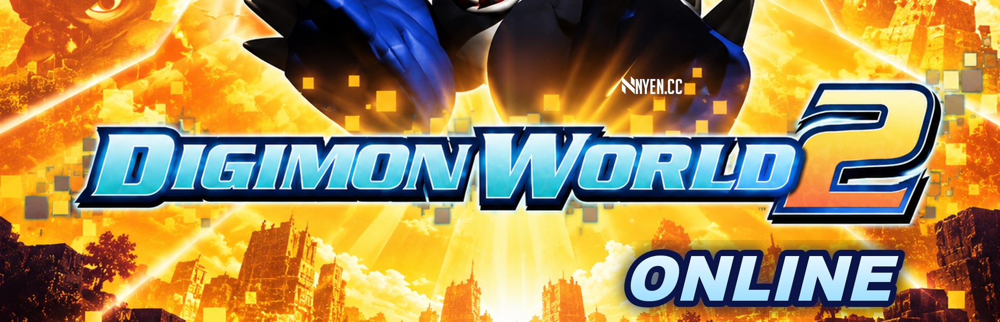
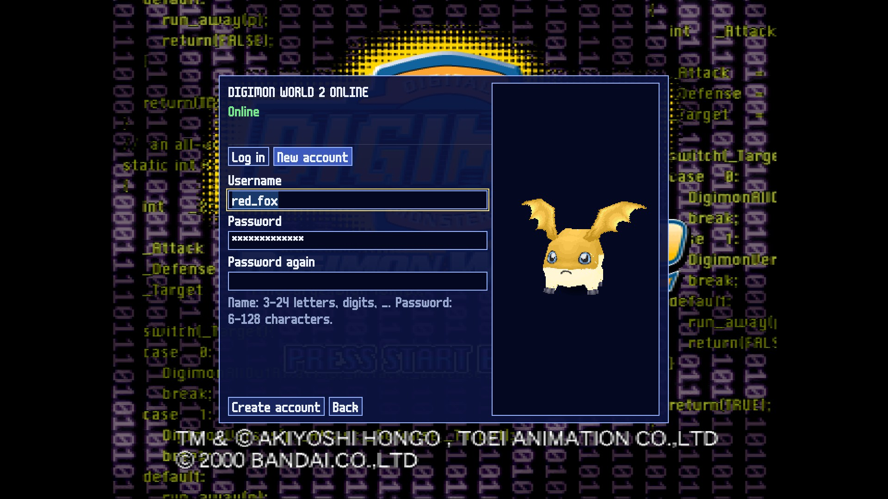
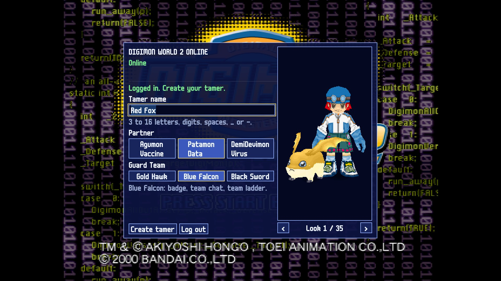
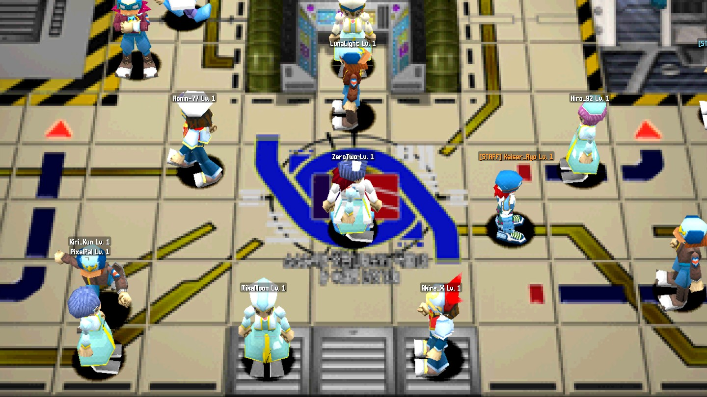
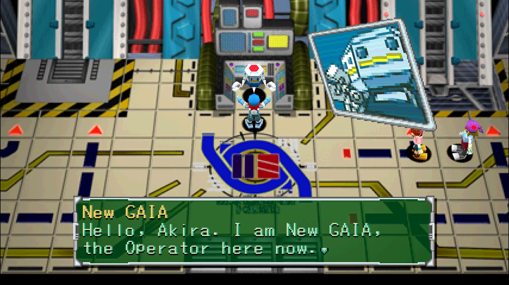
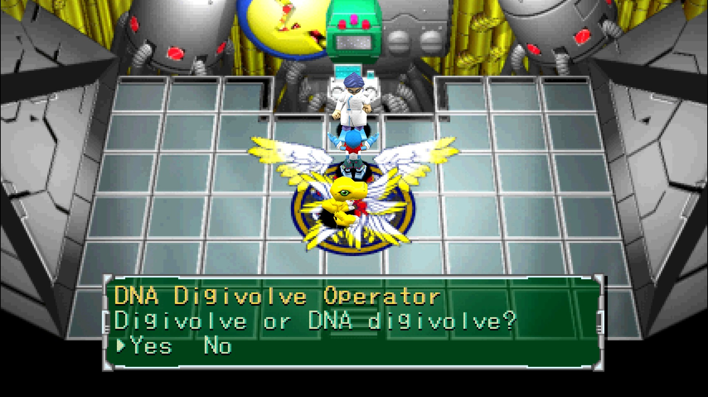
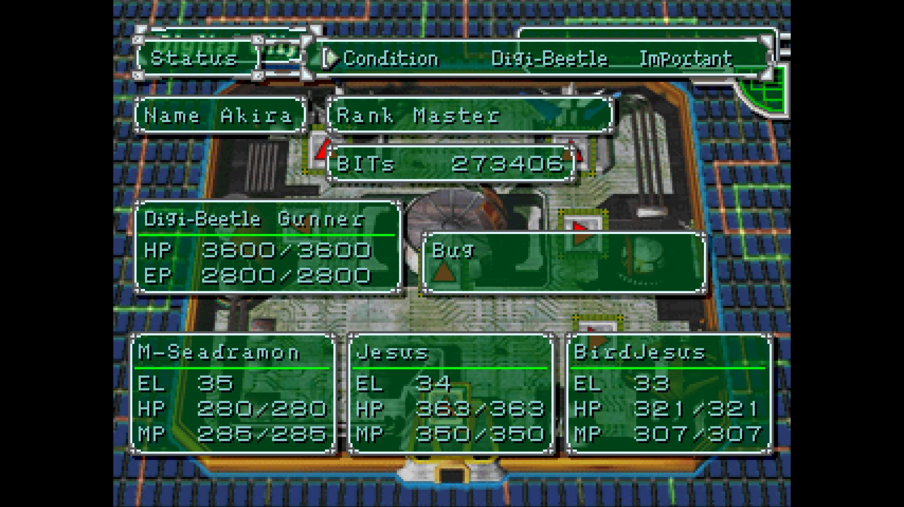
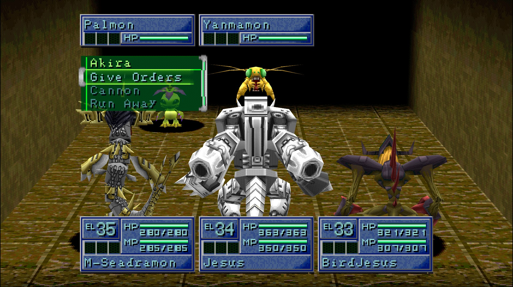
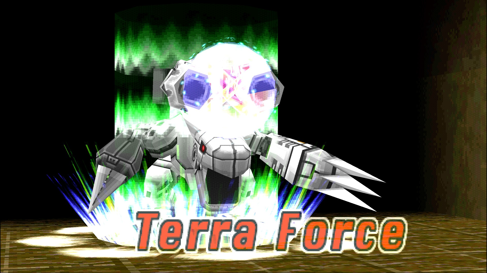
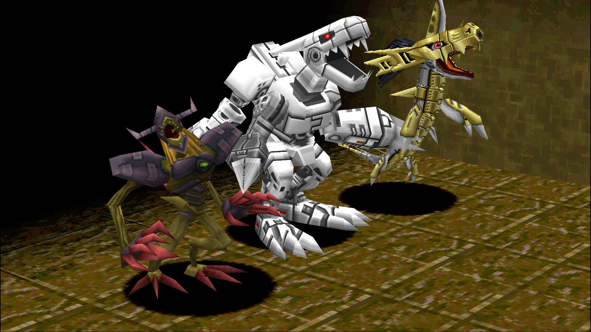

  
   
  Community for DW2 Online and the PC port. Test sign-ups and news are posted there first.

  

<h1 align="center">Digimon World 2 Online</h1>

  <i>Digimon World 2</i> (PlayStation, 2000) as an online game: 
  a shared Digital City, your own tamer, domains, a market and PvP, on a dedicated server.

  
  &nbsp;
  

  
  
  
  

  

  
  
  
   
  
  
  
   
  
  
  

  Pre-alpha screenshots in 16:9 at 1920x1080, render scale 4x. The tamers in the city are test
  accounts on a local server.

  <a href="#about">About</a> &middot;
  <a href="#what-works-today">What works today</a> &middot;
  <a href="#the-online-game">The online game</a> &middot;
  <a href="#roadmap">Roadmap</a> &middot;
  <a href="#devlog">Devlog</a> &middot;
  <a href="#faq">FAQ</a> &middot;
  <a href="#credits">Credits</a>

---

## About

DW2 Online turns *Digimon World 2* into an online game. It runs the game's own code: the
[Digimon World 2 decompilation](https://github.com/Wyrelade/Digimon-World-2-Decomp) turned all
1088 functions of the game into C, and the [PC port](https://github.com/Wyrelade/DW2-PC) runs that
C natively on Windows and Linux. DW2 Online builds on the same code and adds accounts, a server
and other players.

Battles, damage, digivolution, DNA, the domains and the music are the original game. The server
runs the same game code to decide every result, so what you see in your client is what the
server agreed to.

This repository is the project page: screenshots, the devlog, and the downloads once a test
build is out. The game's source code is not published here. The single player PC port is open
source at [Wyrelade/DW2-PC](https://github.com/Wyrelade/DW2-PC).

> [!IMPORTANT]
> **You will need your own copy of the game.** The downloads will contain no disc image and no
> game data (graphics, models, sound, text or code from the disc). The client builds its data
> pack on your PC from your own disc image (USA, `SLUS-01193`) and checks it file by file, the
> same way the PC port does.

> [!NOTE]
> **Pre-alpha.** The game is in development and there is no public server yet. Everything on
> this page can still change. Follow the [devlog](#devlog) or join the
> [Discord](https://discord.gg/nHXAq2fdCJ) for the first closed test.

## What works today

### Online

| | |
|---|---|
| **Accounts** | Log in or make a new account in a panel on the title screen ("ONLINE"). The connection is encrypted (TLS 1.3), and passwords are stored only as Argon2id hashes. |
| **Your tamer** | Pick a tamer name, a partner (Agumon, Patamon or DemiDevimon), a Guard Team (Gold Hawk, Blue Falcon or Black Sword) and one of 35 looks, with a 3D preview of the tamer and the partner. |
| **Profile on the server** | Your tamer, Digimon, items and Digi-Beetle are kept on the server. You start in Digital City with your partner and your first Digi-Beetle. |
| **A shared city** | Other tamers walk through Digital City with you, each in their own look, with a name tag "Name Lv. N" over their head. Up to 49 tamers are drawn at the same time. Staff carry a coloured [STAFF] tag. |
| **The server checks movement** | The server knows the city's floor and refuses moves through walls or faster than a tamer can run. |
| **Short drops do not end your session** | When the connection drops, the game holds with a "Connection lost." box and picks up where you were if it comes back within the grace time. Other players see you stand still for a few seconds, not vanish. |

### On the PC

| | |
|---|---|
| **Smooth frames** | Pictures are drawn at your monitor's refresh rate with smooth movement between the game's frames, while the game logic keeps its original 59.94 Hz timing. On by default, F9 turns it off. |
| **HD picture** | Render scale 1x to 8x, 16:9 widescreen made by widening the camera, no wobbling polygons, perspective correct textures, a GPU renderer. Menus and text keep their original look. |
| **Mouse and gamepad** | Mouse on the menus (hover, click, wheel), any SDL3 gamepad, full keyboard remap. |
| **More memory** | The game has 6 times the PlayStation's memory for models and textures, so a city full of tamers does not run out. |

## The online game

What DW2 Online is meant to be. These are design decisions, not finished features yet.

- **Digital City is the hub.** Meet other tamers, chat, and trade on the market.
- **Domains are your own runs.** A domain item picks the domain, its level (1 to 99) and its
  extra rules: enemy level and density, traps, the boss, loot amount and rarity. Domains drop
  more domain items, so a run leads to the next one. A free level 1 domain is always open.
- **Gear comes from drops.** Digi-Beetle parts and items drop with random extra effects. Top
  items are rare, but normal gear takes you through most of the game.
- **Digimon have a quality.** Each recruit can be Normal, Fine, Rare or Shiny (a palette swap),
  with slightly better growth or stats. DNA digivolution works as in the original game.
- **Guard Teams are your faction.** A badge, team chat, a team ladder and seasonal team rewards.
  They give no power.
- **PvP.** Live turn based battles on the original battle rules, defence teams and seasons.
- **Tamer level.** You gain tamer EXP from battles, bosses and domain clears. The level is
  progress and cosmetics, it locks nothing.
- **Free.** No shop, no paid items.
- **Fair play.** The server decides every battle, drop and roll; the client only shows them.

## Roadmap

Done:

- [x] The whole game code runs on PC (title, city, domains, battles, menus, VS mode)
- [x] The game logic split from the picture, so a server can run it without a window
- [x] Server, database and encrypted connection
- [x] Accounts, login, new account, one tamer per account
- [x] Tamer creation: name, partner, Guard Team, 35 looks
- [x] Profiles on the server, start in Digital City
- [x] Other tamers in the city, name tags, staff tags, movement checks
- [x] Reconnect after a short drop
- [x] Smooth frames in the city

Next:

- [ ] Smooth frames in domains and battles
- [ ] Chat: city channel, Guard Team chat, whispers
- [ ] Player menu (click a tamer: profile, whisper, add friend, block, report)
- [ ] Profile cards with your lineup and stats
- [ ] Friend list
- [ ] Domain runs on the server (Domain Connector, domain items)
- [ ] Market
- [ ] PvP
- [ ] **First closed test** (sign-ups on [Discord](https://discord.gg/nHXAq2fdCJ))

## Devlog

Development notes with pictures, newest first. All posts are in [devlog/](devlog/).

- **2026-10-12** [Smooth frames and a busy Main Gate](devlog/2026-10-12-smooth-frames.md)
- **2026-10-11** [Other tamers in the city](devlog/2026-10-11-the-city-is-shared.md)
- **2026-10-11** [Accounts, tamers and 35 looks](devlog/2026-10-11-accounts-and-tamers.md)
- **2026-10-10** [The plan for DW2 Online](devlog/2026-10-10-the-plan.md)

## FAQ

**Is it free?** Yes. There will be no shop and no paid items.

**When can I play?** There is no date yet. The first test will be a closed test; sign-ups and
news go to the [Discord](https://discord.gg/nHXAq2fdCJ) first.

**Which systems?** Windows x64 first. Linux x64 builds already run.

**Do I need the original game?** Yes. Like the PC port, the client builds its data from your own
disc image (USA, `SLUS-01193`).

**Is the source code open?** The online game's code is not published, to keep the server fair
and the game safe from cheats. The decompilation and the single player PC port are open:
[Digimon-World-2-Decomp](https://github.com/Wyrelade/Digimon-World-2-Decomp) and
[DW2-PC](https://github.com/Wyrelade/DW2-PC).

**Will my PC port or PS1 save carry over?** No. Online tamers start fresh on the server, so
everyone has the same start.

**Can I help?** Join the Discord. Testers are welcome once the closed test opens, and bug reports
go to [issues](https://github.com/Wyrelade/DW2-Online/issues) here.

## Credits

- **[Wyrelade](https://github.com/Wyrelade)**: founder and lead of the project; the
  [Digimon World 2 decompilation](https://github.com/Wyrelade/Digimon-World-2-Decomp), the
  [PC port](https://github.com/Wyrelade/DW2-PC) and DW2 Online.
- DW2 file-format documentation by RmBeastbow.
- Thanks to ThirstyWraith for the stage overlay and battle notes.
- Built with [SDL3](https://libsdl.org/), [Dear ImGui](https://github.com/ocornut/imgui),
  [Mbed TLS](https://github.com/Mbed-TLS/mbedtls), [libsodium](https://libsodium.org/) and
  [PostgreSQL](https://www.postgresql.org/).

## Legal

DW2 Online is a fan project and is not affiliated with or endorsed by Bandai Namco or Toei
Animation. Digimon World 2, its data, its characters and its logo belong to their owners. No game
data is in this repository or its downloads. The banner (`misc/banner.png`) is fan art and uses
the game's logo only to name the game. The screenshots show the game running on PC from the
author's own disc.

---

  
   
  Powered by <a href="https://nyen.cc/"><b>NYEN</b></a>

